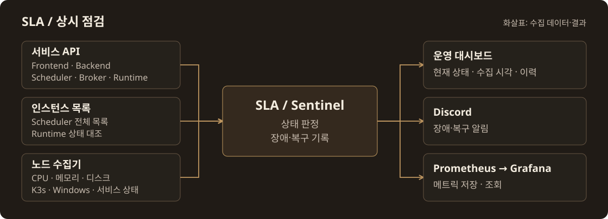

<h1>MSG CTF · SLA / Sentinel</h1>

서비스·인스턴스·노드 감시 · 장애·복구 알림

<a href="https://msg-ctf.github.io/platform.html">플랫폼</a> · <a href="#development">개발 문서</a>

<h2 align="center">Overview</h2>

인스턴스 생성·종료와 별도로 상태를 수집합니다
장애·복구 알림은 Sentinel이 Discord로 보내고, Prometheus가 메트릭을 수집합니다

[수집·알림 구현](docs/showcase/README.md) · [메트릭 수집 설정](monitoring/README.md)

<h2 align="center">Contributors</h2>

<table align="center">
<tr><th align="center" colspan="6"><a href="https://github.com/MSG-CTF/sentinel">SLA</a></th><th align="center" colspan="6"><a href="https://github.com/MSG-CTF">PM</a></th></tr>
<tr>
<td align="center" valign="top" colspan="6" width="390"> <a href="https://github.com/minsoo0506"><b>minsoo0506</b></a> SLA 계약·.NET 초기 구조 상태 수집·메트릭</td>
<td align="center" valign="top" colspan="6" width="390"> <a href="https://github.com/jongcoding"><b>jongcoding</b></a> 실제 서버·전체 인스턴스 감시 운영 화면·AWS 배포</td>
</tr>
</table>

기여 기록 · 관련 PR

| 기여자 | 기여 내용 | 관련 PR |
| --- | --- | --- |
| [minsoo0506](https://github.com/minsoo0506) | SLA 계약·.NET 기본 구조, health check worker와 Prometheus metrics | [#10](https://github.com/MSG-CTF/sentinel/pull/10) · [#13](https://github.com/MSG-CTF/sentinel/pull/13) · [#15](https://github.com/MSG-CTF/sentinel/pull/15) |
| [jongcoding](https://github.com/jongcoding) | 실제 서버·전체 인스턴스 감시, 운영 대시보드·AWS 배포·노드 수집 연결 | [#18](https://github.com/MSG-CTF/sentinel/pull/18) · [#35](https://github.com/MSG-CTF/sentinel/pull/35) · [#44](https://github.com/MSG-CTF/sentinel/pull/44) |

<h2 align="center">Tech Stack</h2>

 &nbsp;  &nbsp;  &nbsp;  ASP.NET Core · Prometheus · Grafana · Docker C# · .NET 8 · AWS

## Development

- [로컬 실행과 검증](local/README.md)
- [AWS 배포](deploy/aws/README.md)
- [브로커 노드 감시](deploy/telemetry/BROKER-FLEET.md)
- [실행 준비 상태 관측](docs/runtime-readiness.md)
- [설치·실행 안내](README.reference.md)

<a href="https://github.com/MSG-CTF/msg-ctf.github.io/blob/67e93a09ce630910f98ae56fb118ca1317af78e0/docs/tech-icons.md">아이콘 출처</a>

